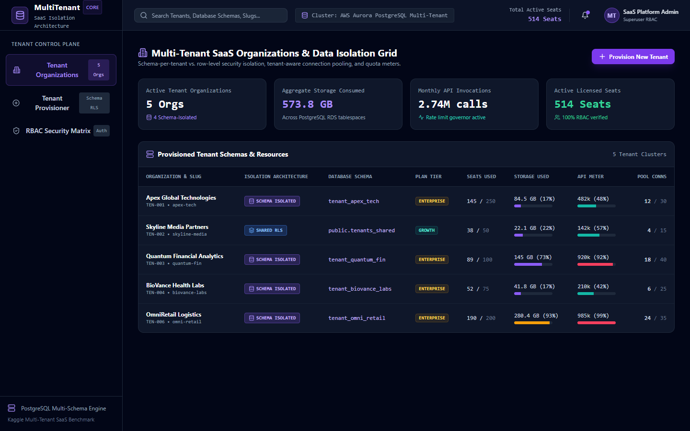
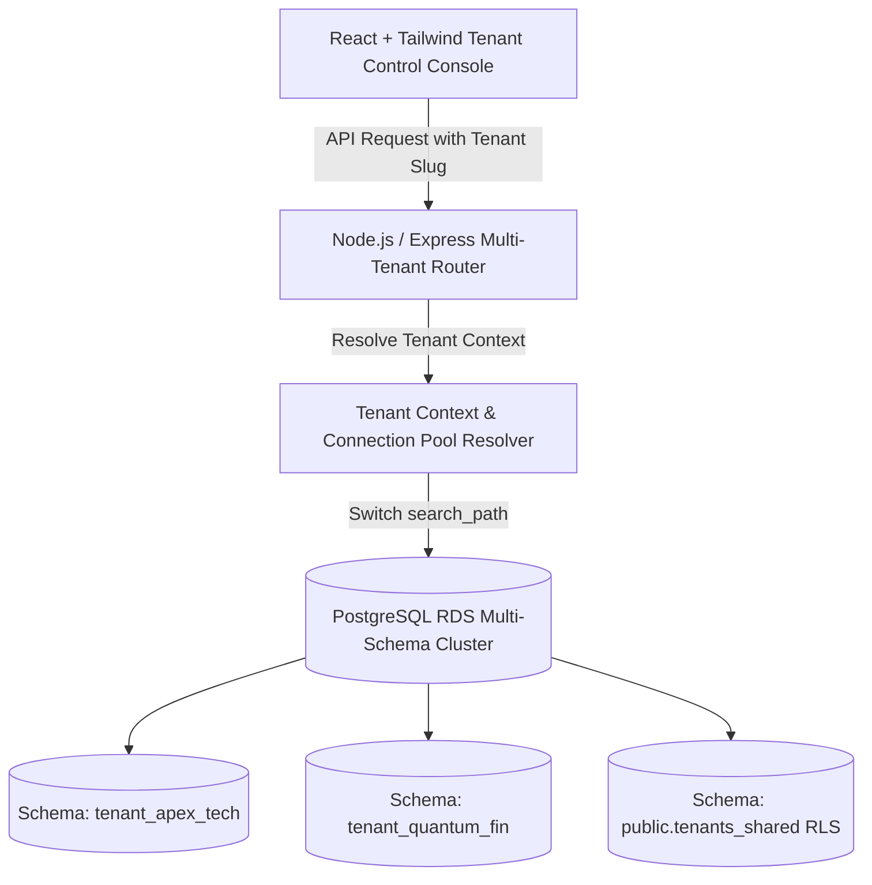

# MultiTenant SaaS Core — Architecture, Isolation & Data Provisioning Platform

[](LICENSE)
[](https://nodejs.org/)
[](https://react.dev/)
[](https://tailwindcss.com/)
[](data/kaggle_multitenant_saas_benchmark.csv)
[](https://www.docker.com/)

MultiTenant SaaS Core is an enterprise multi-tenancy management and database isolation platform. Designed for B2B cloud architectures, it handles automated tenant provisioning, schema-per-tenant vs. row-level security (RLS) isolation strategies, tenant-aware PostgreSQL connection pooling, fine-grained RBAC policies, and real-time usage quota enforcement.

---

## 📸 System Dashboard & Tenant Resource Grid



---

## 🌟 Key Capabilities & Standout Features

- **Dual Multi-Tenancy Architecture**: Supports both **Schema-per-Tenant** (dedicated database schemas `tenant_{slug}` for maximum compliance and data isolation) and **Row-Level Security (RLS)** (shared tables with PostgreSQL row security).
- **Automated Schema Provisioning Engine**: Instantly generates PostgreSQL DDL scripts (`CREATE SCHEMA`, `SET search_path`, permission grants) upon tenant signup.
- **Tenant-Aware Connection Pooling**: Allocates isolated database connection pools per customer with configurable concurrency limits and idle timeouts.
- **Role-Based Access Control (RBAC)**: Fine-grained security matrix across **Owner**, **Admin**, **Member**, and **Auditor** roles.
- **Resource Quota Enforcement**: Live monitoring of licensed seats, database storage consumption, and monthly API rate limits.

---

## 🏛 Architecture Overview



---

## 📊 Dataset Benchmark

The repository includes a curated benchmark in [`data/kaggle_multitenant_saas_benchmark.csv`](data/kaggle_multitenant_saas_benchmark.csv) covering:
- `tenant_id`: Unique tenant identifier (e.g., `TEN-001`)
- `organization_name` & `slug`: Enterprise name and subdomain slug
- `isolation_mode`: `SCHEMA_PER_TENANT` or `ROW_LEVEL_SECURITY`
- `database_schema`: Allocated PostgreSQL schema name
- `tier`: `ENTERPRISE`, `GROWTH`, or `STARTER`
- `active_seats` & `seat_limit`: Licensed user seats
- `storage_used_gb` & `storage_quota_gb`: Dedicated tablespace allocation
- `monthly_api_calls` & `quota_limit_calls`: Rate limits and monthly volume
- `status`: `ACTIVE` or `QUOTA_WARNING`

---

## 🔌 API Reference

| Endpoint | Method | Description |
| :--- | :--- | :--- |
| `/health` | `GET` | Health check & cluster readiness |
| `/api/v1/analytics/cluster-summary` | `GET` | Aggregated tenant metrics: storage, seats, API volume, and isolation ratio |
| `/api/v1/tenants` | `GET` | List all provisioned tenant organizations and resource meters |
| `/api/v1/tenants/{id}` | `GET` | Detailed connection pool and RBAC configuration for a tenant |
| `/api/v1/tenants` | `POST` | Onboard and provision a new tenant with automated DDL execution |
| `/api/v1/tenants/{id}/update-quota` | `POST` | Modify storage, seat, or API call limits |

---

## 🚀 Quickstart Guide

### Option 1: Docker Compose (Recommended)

```bash
docker-compose up --build
```
- Web Application: `http://localhost:3009`
- Backend API: `http://localhost:5005`

### Option 2: Local Development

#### 1. Backend Service
```bash
cd backend
npm install
npm run dev
```

#### 2. Frontend Application
```bash
cd frontend
npm install
npm run dev
```

---

## 📄 License
This project is licensed under the MIT License.
